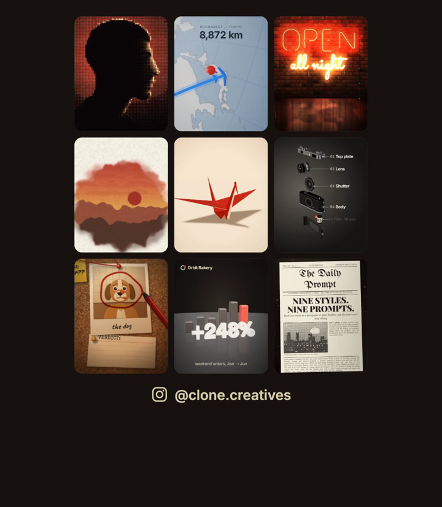

# Claude animation styles

**9 animation styles for Claude Code, one command each.** Type `/neon OPEN late` and Claude makes a 9:16 animation with your words, rendered on your own computer with [Remotion](https://www.remotion.dev/).

Made by [@clone.creatives](https://www.instagram.com/clone.creatives/). These are the exact animations from the reel; each one started from the prompt in `prompts/`.



## The 9 commands
| Command | What you get | Add your words |
|---|---|---|
| `/particles` | your portrait out of 10,000 dots | `/particles me.jpg` |
| `/flight-path` | a 3D globe, the flight draws itself, km counter | `/flight-path Paris to New York` |
| `/neon` | a neon sign buzzing to life on a wet brick wall | `/neon OPEN late` |
| `/case-board` | a detective board, red string, "GUILTY" | `/case-board who stole my charger?` |
| `/origami` | a paper sheet folds into a crane and flies off | `/origami blue paper` |
| `/exploded` | a 35 mm camera pulled apart, every part labelled | `/exploded` |
| `/front-page` | an old-movie newspaper spin | `/front-page THE DAILY BAKE: WE OPENED` |
| `/watercolor` | a watercolour landscape blooms on paper | `/watercolor "sunday walks"` |
| `/stat-3d` | a 3D number climbs over rising bars | `/stat-3d Luna Cafe +312% weekend orders` |

## Install
You need [Claude Code](https://claude.com/claude-code) and **Node 18+**.

**macOS / Linux:**
```bash
git clone https://github.com/cloneaisystem-cell/claude-animation-styles ~/.claude/skills/animation-styles
mkdir -p ~/.claude/commands && cp ~/.claude/skills/animation-styles/commands/*.md ~/.claude/commands/
cd ~/.claude/skills/animation-styles/template && npm install
```

**Windows (PowerShell):**
```powershell
git clone https://github.com/cloneaisystem-cell/claude-animation-styles "$env:USERPROFILE\.claude\skills\animation-styles"
New-Item -ItemType Directory -Force "$env:USERPROFILE\.claude\commands" | Out-Null
Copy-Item "$env:USERPROFILE\.claude\skills\animation-styles\commands\*.md" "$env:USERPROFILE\.claude\commands\"
cd "$env:USERPROFILE\.claude\skills\animation-styles\template"; npm install
```

Then reopen Claude Code in any folder and type `/neon`. Or just paste this into Claude Code and let it do the install:
```
Install the Claude Code skill from https://github.com/cloneaisystem-cell/claude-animation-styles into ~/.claude/skills/animation-styles (git clone, or the ZIP if I don't have git), copy its commands/*.md into ~/.claude/commands/, check I have Node 18+, then run npm install in its template folder. Tell me when /neon is ready.
```

## Without Claude
```bash
cd ~/.claude/skills/animation-styles/template
npm run studio                                   # preview all 9, live
npx remotion render src/index.ts neon out/neon.mp4
```
The words live in `template/src/styles/<Style>.tsx`. The prompts behind each style are in `prompts/`.

## Licences
- This code: MIT (see `LICENSE`).
- [Remotion](https://www.remotion.dev/license) is free for individuals and companies of up to 3 people. Bigger teams need a Remotion company licence.
- Fonts: Google Fonts (OFL). Map: Natural Earth via [world-atlas](https://github.com/topojson/world-atlas). 3D: [three.js](https://threejs.org) (MIT).
- `template/public/portrait.png` is the @clone.creatives avatar, included as an example. Swap in your own photo.
- Not affiliated with Anthropic. "Claude" is a trademark of Anthropic.
